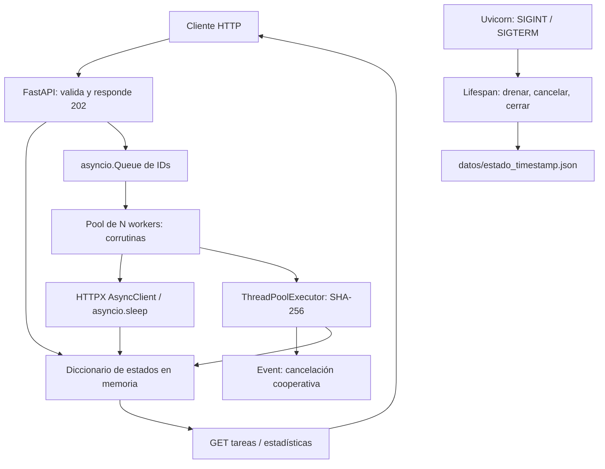

# TP2 — Plataforma de Tareas Distribuidas

Computación II · Universidad de Mendoza · 2026 · Trabajo individual.

Implementación basada en la [consigna oficial completa](https://github.com/Catedra-de-Computacion-II/compu2_um_2026/blob/main/trabajos_practicos/TP2_tareas/consigna.md), consultada el 03/11/2026. Python 3.12, FastAPI, asyncio, HTTPX y ThreadPoolExecutor. Sin bases de datos ni frameworks de colas. Los workers distribuyen trabajo **dentro de una instancia** del servicio.

## 1. Descripción, ejecución y uso

Desde Ubuntu, con Docker Engine y el plugin Compose instalados:

```bash
cd ~/Computacion2/Computacion_II_entrega/TP2
docker compose up --build
```

API: <http://127.0.0.1:8000>. Documentación interactiva: <http://127.0.0.1:8000/docs>. La API se publica en el loopback del host. No necesita Python ni dependencias instaladas en Ubuntu. El usuario debe tener acceso al daemon Docker; si su instalación lo requiere, anteponer `sudo` a los comandos Docker.

En otra terminal:

```bash
# El POST responde 202 con id y estado pendiente, sin esperar la ejecución.
curl -sS -X POST http://localhost:8000/tareas \
  -H 'Content-Type: application/json' \
  -d '{"tipo":"esperar","parametros":{"segundos":10},"timeout":20}'

curl -sS -X POST http://localhost:8000/tareas \
  -H 'Content-Type: application/json' \
  -d '{"tipo":"hashear","parametros":{"texto":"hola","iteraciones":3000000},"timeout":30}'

curl -sS -X POST http://localhost:8000/tareas \
  -H 'Content-Type: application/json' \
  -d '{"tipo":"descargar","parametros":{"urls":["https://www.python.org/","https://example.com/"]},"timeout":30}'

curl -sS http://localhost:8000/tareas
curl -sS 'http://localhost:8000/tareas?estado=completada&limite=20&offset=0'
curl -sS http://localhost:8000/estadisticas

# Copiar el id devuelto por el POST:
ID='reemplazar-por-id-real'
curl -sS "http://localhost:8000/tareas/$ID"
curl -sS -X DELETE "http://localhost:8000/tareas/$ID"

# Timeout reproducible: pasa a fallida con motivo Timeout.
curl -sS -X POST http://localhost:8000/tareas \
  -H 'Content-Type: application/json' \
  -d '{"tipo":"esperar","parametros":{"segundos":5},"timeout":0.1}'
```

Los nombres de tipo se envían **en minúsculas**, como en la consigna. Los estados son `pendiente`, `ejecutando`, `completada`, `fallida` y `cancelada`. El timeout cuenta desde que un worker inicia la ejecución, no desde el ingreso en cola. Es obligatorio que sea positivo; por defecto son 30 segundos. Para repetir una tarea se crea otra con POST.

| Ruta | Respuesta |
| --- | --- |
| `POST /tareas` | 202 con registro inicial, incluidos id y estado |
| `GET /tareas` | Lista; filtro `estado`, paginación `limite` y `offset` |
| `GET /tareas/{id}` | Estado, parámetros, resultado, error y tiempos |
| `DELETE /tareas/{id}` | Cancela; repetirlo es idempotente; una tarea terminal no cambia |
| `GET /estadisticas` | Totales por estado, promedios, cola y workers |

IDs inexistentes devuelven 404; parámetros inválidos, 422; cola llena o servicio cerrando, 503. Se rechazan campos extra y URLs que no sean HTTP/HTTPS. Los límites de entrada están en `app/modelos.py`: 100 URLs, texto de 100.000 caracteres, 100 millones de iteraciones, espera y timeout de hasta 3600 segundos.

El hash aplica `digest = sha256(digest).digest()` N veces, partiendo del texto UTF-8, y devuelve el último digest en hexadecimal. Las descargas devuelven `codigo_http`, `tamano_bytes`, `segundos` y `error` para cada URL. El tamaño corresponde a bytes del cuerpo decodificado por HTTPX. Se siguen redirecciones y se consumen cuerpos por streaming. Un 404 es un resultado HTTP válido; un fallo de conexión queda en `error` de esa URL. La tarea de descarga se considera completada cuando termina el relevamiento de todas sus URLs, incluso si algunas reportan errores individuales. Un timeout global o una excepción de la operación sí produce `fallida`.

Configuración por variables de entorno:

| Variable | Valor inicial | Significado |
| --- | --- | --- |
| `WORKERS` | 4 | Corrutinas consumidoras de tareas |
| `HILOS_CPU` | 2 | Hilos máximos del executor de hash |
| `CAPACIDAD_COLA` | 1000 | Máximo de entradas pendientes en la cola |
| `PLAZO_APAGADO` | 5 | Segundos para drenar normalmente la cola |
| `DIRECTORIO_ESTADO` | `/tp2/datos` en Compose | Destino de volcados |

Ejemplo: `WORKERS=8 HILOS_CPU=2 docker compose up --build`. Mantener **un solo proceso Uvicorn**: varios procesos tendrían diccionarios y colas independientes. Workers de aplicación e hilos CPU son cantidades distintas.

### Pruebas y comprobaciones reproducibles

```bash
# Pruebas automatizadas dentro de una imagen actualizada:
docker compose run --rm --build api python -m pytest -q

# Verificación HTTP real del servicio levantado (deja tareas de prueba):
docker compose exec api python -m scripts.verificar_http

# Las tres mediciones. La carpeta resultados ya forma parte del repositorio.
docker compose run --rm -v "$PWD/resultados:/tp2/resultados" \
  api python -m scripts.medir --salida resultados/mediciones.json

# Apagado ordenado del servicio y revisión del volcado:
docker compose stop
ls -lt datos/estado_*.json
docker compose logs api

# Al reiniciar, los logs reportan los volcados anteriores:
docker compose up -d
docker compose logs api
```

`Ctrl+C` en el Compose en primer plano también inicia el cierre. No usar `docker kill` con SIGKILL para probar un apagado ordenado. `docker compose kill -s SIGINT api` y `docker compose kill -s SIGTERM api` permiten probar las otras señales explícitamente. Las pruebas automatizadas envían ambas a procesos Uvicorn reales y verifican el JSON resultante.

También se puede trabajar sin Docker con Python 3.11+:

```bash
python3 -m venv .venv
source .venv/bin/activate
pip install -r requirements.txt
python -m uvicorn app.main:app --host 127.0.0.1 --port 8000 --workers 1
# En otra terminal con el mismo entorno:
python -m pytest -q
python -m scripts.medir
```

## 2. Arquitectura y flujo de tareas



1. El endpoint crea un registro y encola su ID mediante `put_nowait`; no espera el resultado.
2. Un worker hace `await cola.get()`, marca `ejecutando` y crea una tarea hija para poder cancelarla sin destruir al worker.
3. `wait_for` aplica el timeout de ejecución. La operación usa I/O asíncrono o el executor.
4. El worker registra resultado/error, duración y fecha de fin. `task_done()` se ejecuta en un `finally`, incluso al cancelar o fallar.
5. GET consulta el diccionario compartido; DELETE marca cancelación y cancela la hija. El cierre espera `cola.join()` y exporta el estado.

Archivos por responsabilidad:

| Archivo | Responsabilidad |
| --- | --- |
| `app/main.py` | API y lifespan |
| `app/modelos.py` | Validación, tipos y estados |
| `app/config.py` | Configuración |
| `app/gestor.py` | Cola, workers, cancelación, estadísticas y cierre |
| `app/operaciones.py` | Descargas, espera y hash |
| `tests/` | Contratos, concurrencia, cancelación, errores y señales |
| `scripts/` | Mediciones y comprobación HTTP |
| `resultados/` | Datos medidos y evidencia de validación |

## 3. Decisiones de diseño

### Cola, concurrencia y estado compartido

`asyncio.Queue` espera sin bloquear el hilo del event loop. `queue.Queue.get()` bloqueante congelaría ese hilo si la cola estuviera vacía. El límite de la cola permite rechazar sobrecarga con 503 en vez de aceptar infinitos pendientes. No se espera un hueco en el POST, de manera que su respuesta no depende del tiempo de ejecución de las tareas.

Las modificaciones del diccionario se hacen desde un único event loop y sin `await` en medio de cada transición. Por eso no necesitan un `Lock`. El hilo CPU **no modifica ese diccionario**; recibe datos y una señal `threading.Event`, que sí está preparada para comunicación entre hilos. Las corrutinas intercalan trabajo al suspenderse con `await`; eso no implica paralelismo de CPU.

Para URLs de una misma tarea se usa `TaskGroup`: todas comienzan concurrentemente y se espera su terminación. Un `for` con `await descargar_una(...)` en cada vuelta sería secuencial; se utiliza justamente como referencia en la medición. HTTPX permite un cliente asíncrono compartido, conexiones reutilizables y cierre mediante context managers. Hay hasta 100 conexiones HTTP simultáneas en ese cliente, independientemente del número de tareas worker.

### CPU y executor

`run_in_executor` saca el bucle de SHA-256 del hilo del event loop. Se eligió `ThreadPoolExecutor` para mantener sencilla y verificable la cancelación cooperativa con `threading.Event`. En CPython, estos hashes pequeños y el bucle Python compiten por el GIL: los hilos mantienen la API atendible, pero **no garantizan acelerar el cálculo ni usar todos los núcleos**. La medición muestra el costo en latencia que todavía existe.

Un `ProcessPoolExecutor` sería útil para paralelismo de CPU, pero necesitaría otra comunicación de cancelación entre procesos. No se afirma que cancelar un Future detenga un hilo o proceso ya en ejecución. La variante que bloquea el loop existe únicamente en `scripts/servidor_api_medicion.py`, en un proceso de laboratorio; el Dockerfile siempre arranca `app.main:app` con executor.

### Cancelación, timeouts y recursos

Para una pendiente, DELETE cambia el estado; el worker descartará su ID al extraerlo y hará `task_done()`. No se accede a atributos privados de Queue para quitar entradas. Por eso una cancelación pendiente puede seguir ocupando una entrada física hasta que un worker la consuma.

Para una ejecutando, DELETE marca `cancelada` y llama a `cancel()` sobre la tarea hija. `asyncio.sleep` se interrumpe; `TaskGroup` cancela y espera todas las descargas hijas; los contextos `cliente.stream` cierran respuestas y conexiones que quedaron a medio consumir. Cancelar una descarga no puede deshacer lo que el servidor remoto ya recibió.

Para CPU, la señal se comprueba cada **1024 iteraciones**. `asyncio.shield` evita perder el futuro del executor cuando se cancela la corrutina; el manejador de cancelación señala y espera que el hilo termine realmente antes de liberar el worker. El tiempo hasta detenerse depende del chequeo, del GIL y del planificador; no es una detención instantánea ni un plazo de tiempo real. Las pruebas verifican que un segundo hash se ejecuta en el mismo executor de un solo hilo después de cancelar o agotar el timeout del primero.

El estado `cancelada` se devuelve inmediatamente; durante la limpieza aún puede contarse un worker ocupado. `wait_for` cancela la hija al vencer el timeout y espera su limpieza antes de registrar `fallida`. Por eso la duración puede superar ligeramente el timeout. La cancelación aceptada prevalece si DELETE llega cuando la hija terminó pero el worker todavía no registró su resultado; hay una prueba específica de esa carrera.

### Errores y supervivencia del pool

Una excepción de operación se registra en `error`, pasa la tarea a `fallida` y el worker continúa. `CancelledError` se trata por separado para que cancelar una tarea no mate al consumidor. Si el propio worker termina inesperadamente, un callback observa su excepción y lo reemplaza, dejando log y contador `reinicios_workers`. Durante el cierre se desactiva ese reemplazo. Las pruebas fuerzan tanto una excepción de operación como una interrupción de worker. No se capturan `KeyboardInterrupt` ni `SystemExit` como errores de negocio.

### Apagado, señales y persistencia

Uvicorn recibe SIGINT/SIGTERM y deja de aceptar conexiones. El `lifespan` pone `aceptando=False`, espera que se drene la cola hasta `PLAZO_APAGADO` y, al vencer ese plazo, cancela pendientes y ejecutando. Luego espera la limpieza cooperativa, termina workers, cierra HTTPX y hace `executor.shutdown(wait=True, cancel_futures=True)` fuera del event loop. Finalmente escribe `datos/estado_<timestamp>.json`, incluyendo tareas y estadísticas.

El plazo limita la espera de **trabajo normal**, no promete un límite duro para cerrar el sistema operativo o un disco trabado. La liberación CPU añade el tiempo de reconocer la señal. Compose concede 20 segundos antes de forzar la terminación; el valor inicial de drenado es 5 segundos. Si se aumenta `PLAZO_APAGADO`, también se debe ampliar `stop_grace_period`. Uvicorn tiene además 10 segundos para drenar solicitudes HTTP. Un SIGKILL, corte de energía o error de escritura puede impedir el volcado.

Al iniciar se registran por log todos los `estado_*.json` existentes. Se **detectan**, pero no se restauran ni reejecutan tareas: la consigna solo pide reportar su existencia. Los JSON se conservan en un volumen enlazado a `TP2/datos` del host y se excluyen de Git.

### Estadísticas reales

`por_estado` se calcula recorriendo registros reales. `workers_ocupados` cuenta hijas aún en curso, incluida limpieza o espera por un hilo del executor. `tiempo_promedio_ejecucion` incluye tareas ejecutadas ya finalizadas (también fallidas y canceladas); `tiempo_promedio_cola` incluye las que ya empezaron. Ambos usan segundos; sin muestras valen 0. La duración se mide con reloj monótono, mientras que las fechas de registro están en UTC. `entradas_cola` incluye IDs cancelados todavía sin consumir; no equivale necesariamente a pendientes.

## 4. Tres mediciones reales

Datos completos, incluidas todas las repeticiones: [resultados/mediciones.json](resultados/mediciones.json). Ejecución del **03/11/2026 a las 18:56 UTC**, dentro de Docker sobre Ubuntu, x86-64, 12 CPUs lógicas visibles, Python **3.12.16**, FastAPI 0.115.12, HTTPX 0.28.1 y Uvicorn 0.34.2. Se realizaron **tres repeticiones** y se informa la mediana. No se excluyeron muestras por ser lentas. Son mediciones de este entorno, no garantías universales.

### 4.1 Veinte descargas: secuencial frente a concurrente

Servidor Uvicorn en otro proceso, con sockets TCP reales por loopback. Cada respuesta demora 100 ms mediante `asyncio.sleep` y contiene 16.384 bytes. Se valida código 200 y tamaño en todas las respuestas. El caso secuencial llama a la misma función de descarga 20 veces; el concurrente envía una tarea con 20 URLs a la API y espera su resultado. El tiempo concurrente **incluye POST y consultas**, por lo que la comparación es conservadora. Hay un calentamiento fuera de la medición.

| Repetición | Secuencial (s) | Concurrente (s) | Speedup |
| --- | ---: | ---: | ---: |
| 1 | 2,0541 | 0,1505 | 13,65× |
| 2 | 2,0765 | 0,1563 | 13,29× |
| 3 | 2,0852 | 0,1534 | 13,59× |
| Mediana | **2,0765** | **0,1534** | **13,59×** |

El speedup se calcula por repetición como tiempo secuencial / tiempo concurrente; la última columna final es la mediana de esos cocientes. Las esperas de red se superponen. No se llega a 20× por creación de conexiones, transporte HTTP, validación, planificación y consultas del resultado. El retardo es controlado y el tráfico es real; estos resultados no describen el ancho de banda de Internet.

### 4.2 GET /tareas durante CPU sin executor y con executor

Tres millones de iteraciones SHA-256. La API corre en otro proceso, para que el cliente medidor siga funcionando aunque el servidor bloquee. El proceso servidor crea un marcador justo antes del cálculo; el cliente espera ese marcador y 50 ms antes de enviar GET. Así el pedido se hace durante el trabajo, y no después. Se verifica que el hash termine correctamente en ambos modos.

| Modo | Latencias GET por repetición (ms) | Mediana GET (ms) | Duraciones del cálculo (s) |
| --- | --- | ---: | --- |
| Sin executor, variante de laboratorio | 1149,25 / 1173,90 / 1172,18 | **1172,18** | 1,200 / 1,224 / 1,223 |
| Con executor, implementación entregada | 11,77 / 21,89 / 22,32 | **21,89** | 1,273 / 1,315 / 1,325 |

Sin executor, el GET espera casi todo lo que resta del cálculo: no hay un `await` que libere el event loop dentro del bucle CPU. Con executor responde durante el cálculo; el costo del GIL sigue siendo visible. El hash no se volvió más rápido: la mejora buscada es la capacidad de atender otros pedidos.

### 4.3 Techo del pool

Cuatro workers, tareas `esperar` de 0,2 segundos, enviadas concurrentemente por HTTP. Se aumenta el tamaño del lote hasta 32; cada tamaño tiene tres repeticiones. El reloj del lote incluye POSTs y consultas. La latencia individual abarca desde creación hasta finalización. La espera en cola se obtiene de los registros del servidor.

| Tareas del lote | Lote: mediana (s) | Tareas/s | Latencia media: mediana (s) | Espera media en cola: mediana (s) |
| ---: | ---: | ---: | ---: | ---: |
| 1 | 0,2149 | 4,65 | 0,2012 | 0,0005 |
| 2 | 0,2167 | 9,23 | 0,2018 | 0,0004 |
| 4 | 0,2241 | 17,85 | 0,2011 | 0,0003 |
| 8 | 0,4257 | 18,79 | 0,3000 | 0,0990 |
| 16 | 0,8302 | 19,27 | 0,4968 | 0,2956 |
| 32 | 1,6513 | 19,38 | 0,9013 | 0,6979 |

Se observa degradación de latencia al superar **4 tareas activas**: con 8 ya hacen falta dos tandas. El throughput se aproxima a **20 tareas/s**, coherente con 4 / 0,2, mientras crece la espera. Es el techo de este pool y esta carga, no un máximo universal de sockets ni de CPU del equipo. Para hashes, los dos hilos CPU y el GIL imponen otro límite; para descargas importan conexiones y servidores remotos. El script permite reproducir las mediciones; `--repeticiones` y `--iteraciones` ajustan las primeras dos condiciones, y la serie del pool está explícita en `medir_pool`.

## 5. Conceptos del curso relacionados con el código

| Clases / concepto | Aplicación concreta |
| --- | --- |
| 11, productor-consumidor (referencia indicada en la consigna) | `Gestor.crear` produce IDs y `_worker` consume una Queue compartida; aquí se usan corrutinas |
| 13–14, sockets TCP y servidores concurrentes | Uvicorn recibe HTTP sobre TCP; HTTPX abre conexiones para las descargas; las mediciones usan servidores y sockets reales |
| 17, multiplexación con select/epoll | El event loop espera disponibilidad de sockets y temporizadores sin dedicar un hilo bloqueado a cada descarga |
| 18, corrutinas y async/await | `_worker`, `ejecutar` y `descargar_una` suspenden con `await`; esperar no implica ocupar CPU |
| 19, HTTP y FastAPI | Rutas, códigos 202/404/422/503, contratos Pydantic y documentación OpenAPI |
| 20–21, red asíncrona, colas y cancelación | HTTPX AsyncClient, TaskGroup, Queue, wait_for y CancelledError |
| 22, concurrent.futures | ThreadPoolExecutor, futuro del cálculo, GIL y límites de cancelación |
| Bloque 0, context managers y excepciones | Lifespan, contextos de streaming y finally para liberar recursos |

`asyncio.sleep` registra un temporizador y cede el control; `time.sleep` en una corrutina bloquearía el hilo que también atiende HTTP. `gather` inicia varias corrutinas concurrentemente; un `for` con `await` interno espera cada una antes de iniciar la siguiente. TaskGroup agrega un alcance estructurado: al salir, las hijas ya terminaron o fueron canceladas y esperadas.

## 6. Limitaciones conocidas y verificación

- Estado y cola locales a un proceso; sin recuperación de tareas después de reiniciar ni coordinación entre máquinas.
- El historial de tareas permanece en RAM y los volcados se acumulan en disco. La cola es acotada, el historial no tiene política de eliminación. Diez mil POSTs pueden producir 503 al llenarse la cola; miles de tareas terminadas también aumentan memoria, serialización y tamaño del JSON.
- El executor de hilos prioriza sencillez y cancelación cooperativa; no ofrece paralelismo pleno de estos hashes pequeños en CPython. La respuesta HTTP sigue teniendo cierta contención del GIL.
- El timeout cubre ejecución y puede superarse durante limpieza. La espera en cola no vence automáticamente. El apagado espera reconocimiento cooperativo y escritura del JSON.
- Los errores por URL son resultados parciales; no hay reintentos. HTTPX tiene además un timeout de red de 15 segundos y hasta 100 conexiones compartidas.
- Sin autenticación ni cuotas por cliente. Compose publica solo en localhost; las URLs de descarga se consideran entradas de un usuario de confianza.
- No se agregaron extensiones opcionales de producto. Las pruebas se incluyeron porque forman parte del alcance solicitado.

Validación automatizada en Docker: **17 pruebas pasaron en 3,24 segundos**. Cubren creación, consultas/resultados, filtros/paginación, POST inmediato, cuatro tareas concurrentes, cancelaciones pendientes y ejecutando, cancelación y timeout de CPU con liberación del executor, cancelación y timeout de múltiples descargas sin hijas huérfanas, timeout de espera, errores de red/HTTP/operación, validación, cola llena, estadísticas, supervivencia/supervisión del worker, carrera entre cancelación y resultado, apagado con y sin plazo agotado, detección de volcados y SIGINT/SIGTERM reales. Los resultados finales se conservan en [resultados/pruebas.txt](resultados/pruebas.txt). El script HTTP también pasó contra Compose por sockets, incluido un servidor local de descargas; finalizó con cuatro workers vivos, cero ocupados y cola vacía. El puerto publicado respondió desde Ubuntu.

## 7. Aprendizajes personales

Una de las cosas que más me ayudó a entender este trabajo fue la diferencia entre ejecutar varias tareas de manera concurrente y realizar cálculos que consumen mucho procesador. Antes no tenía tan clara esa diferencia y pensaba que utilizar programación asíncrona era suficiente para mejorar el rendimiento. Al revisar cómo funcionan las descargas con asyncio y comparar los resultados de las mediciones, entendí que el programa puede aprovechar los tiempos de espera para atender otras operaciones. Por ejemplo, las 20 descargas tardaron aproximadamente 2 segundos de manera secuencial, mientras que concurrentemente se completaron en unos 0,15 segundos. También entendí que una tarea como calcular hashes es diferente, porque necesita utilizar el procesador constantemente. En ese caso, usar un executor permite que el servidor siga respondiendo mientras se realiza el cálculo, aunque no necesariamente haga que el cálculo termine más rápido.

Otra parte que me resultó interesante, y que al principio me costó comprender, fue el manejo de las cancelaciones y los timeouts. Pensaba que cancelar una tarea era simplemente detener su ejecución o cambiar su estado, pero descubrí que hay que tener en cuenta qué sucede con los recursos que está utilizando. Esto se nota especialmente en el cálculo de hashes, porque cancelar una corrutina no significa que el hilo donde se está ejecutando el cálculo se detenga automáticamente. Por eso se utiliza una señal de cancelación que el propio cálculo comprueba periódicamente. Las pruebas permitieron verificar que, después de cancelar una operación, el executor puede volver a utilizarse para ejecutar otro trabajo. Me sirvió para entender que no alcanza con que el programa muestre el estado correcto, sino que también hay que comprobar qué está pasando internamente.

Por último, creo que una de las decisiones más importantes del proyecto fue utilizar asyncio.Queue junto con un grupo configurable de workers, porque permite organizar las tareas sin bloquear el servidor mientras espera nuevos trabajos. También me parece importante haber separado las operaciones de entrada y salida de los cálculos que utilizan CPU. Si tuviera más tiempo, me gustaría mejorar la persistencia de las tareas para poder recuperarlas después de reiniciar el servidor, ya que actualmente los archivos JSON permiten conservar un registro, pero no continuar los trabajos pendientes. En general, este TP me ayudó a relacionar varios temas que vimos durante el cursado y a darme cuenta de la importancia de probar el funcionamiento real del programa, no solamente comprobar que el código se ejecuta sin errores.